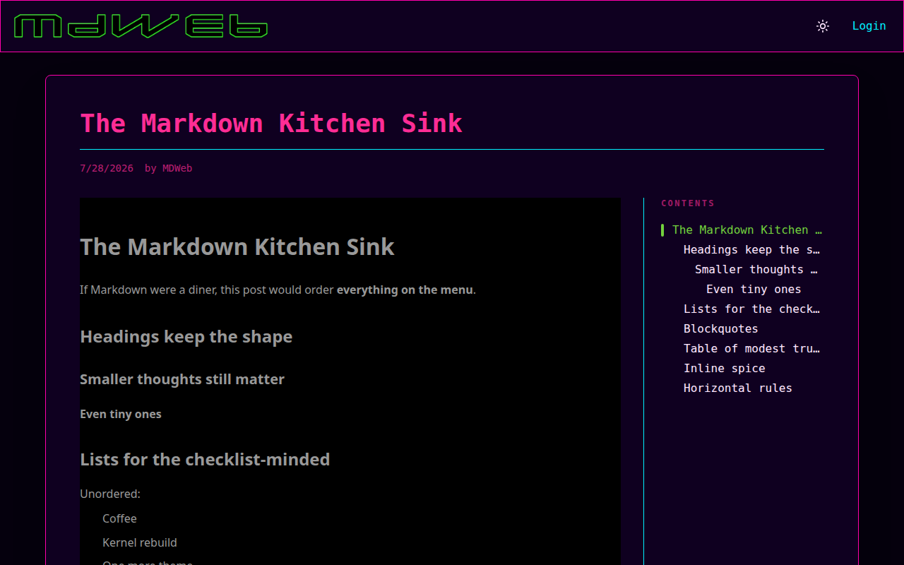
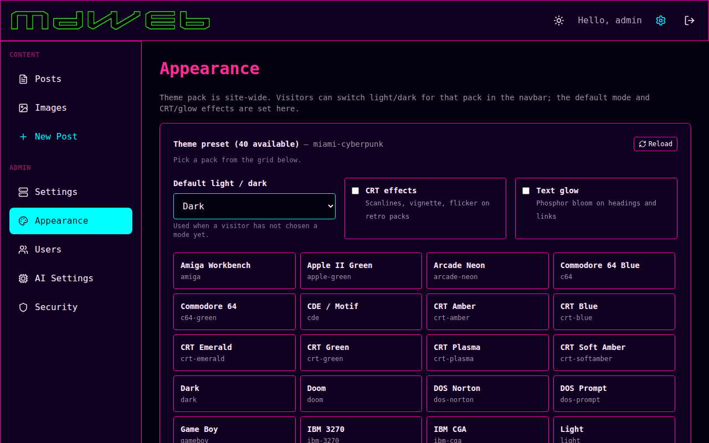
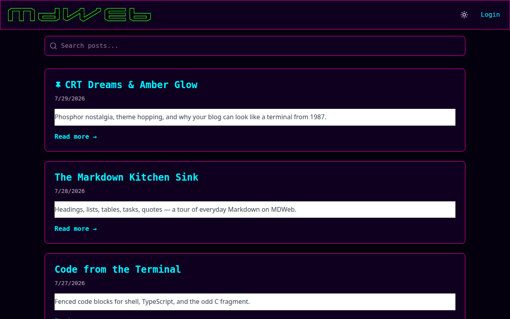
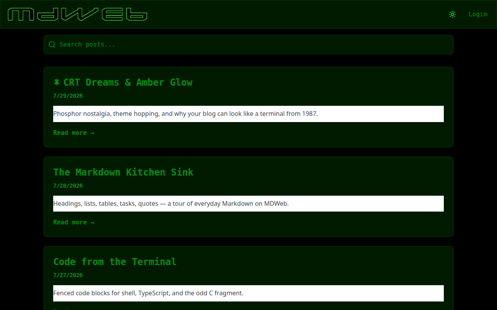
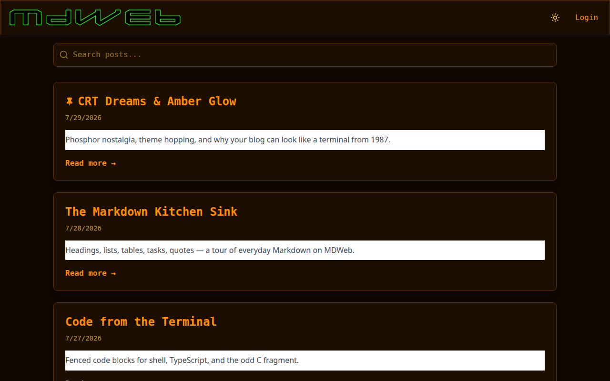

# MDWeb

**A personal website and blog that stores everything as files.**  
Markdown for posts. JSON for settings and themes. **No database.**

You write. You own the files. You run it on your machine — FreeBSD preferred, Node anywhere.

---

## Why this exists

Most “simple” blogs still want Postgres, a cloud account, or a proprietary export. MDWeb does not.

- **Posts are `.md` files** — edit in vim, VS Code, or the built-in admin editor  
- **Config and users are JSON** — readable, greppable, backup with `tar` or ZFS  
- **Themes are JSON color packs** — dozens of skins (CRT, Miami, Win95, Matrix, …), each with light and dark  
- **No MySQL, Postgres, SQLite, or Redis required** for day-to-day operation  

If you can copy a folder, you can move your site.

---

## Screenshots


| A Markdown post | Theme picker (admin) |
|-----------------|----------------------|
|  |  |

Every shipped theme in light and dark: **[docs/THEMES.md](docs/THEMES.md)**

| Miami Cyberpunk | Matrix | CRT Amber |
|-----------------|--------|-----------|
|  |  |  |

---

## What you need

| Install path | Requirements |
|--------------|----------------|
| **FreeBSD package / port** | FreeBSD host, Node (pulled in by the port), a strong secret for login tokens |
| **From source** | Node.js 18+, npm |

That is it. No separate database server to install or tune.

---

## Install on FreeBSD (recommended)

1. Install the `www/mdweb` package or build the port under `ports/www/mdweb/`.  
2. Create a strong JWT secret in a file (required in production). The file must be mode `0600`. The secret is not passed on the command line:

   ```sh
   sudo umask 077
   openssl rand -hex 32 | sudo tee /usr/local/etc/mdweb/jwt.secret >/dev/null
   sudo chown www:www /usr/local/etc/mdweb/jwt.secret
   sudo chmod 0600 /usr/local/etc/mdweb/jwt.secret
   ```

   The rc script exports `JWT_SECRET_FILE` (the path only). A mode other than `0600` refuses to start.

3. Create the admin account. There is no `admin` / `admin` login. Use a one-time setup token or stdin (the password is never an argument):

   ```sh
   cd /usr/local/www/mdweb
   sudo -u www env CONFIG_DIR=/usr/local/etc/mdweb \
     ./node_modules/.bin/tsx server/scripts/bootstrap-admin.ts --issue-token
   # paste the token once:
   printf '%s\n' 'a-long-password' | sudo -u www env CONFIG_DIR=/usr/local/etc/mdweb \
     ./node_modules/.bin/tsx server/scripts/bootstrap-admin.ts \
     --username admin --setup-token 'THE_TOKEN'
   ```

   Or, on the jail console, `--stdin` and a password on standard input. Later changes:

   ```sh
   printf '%s\n' 'a-new-password' | sudo -u www env CONFIG_DIR=/usr/local/etc/mdweb \
     ./node_modules/.bin/tsx server/scripts/change-password.ts admin
   ```

4. Enable and start the service. It listens on `service.host` from `config.json` (default `127.0.0.1`):

   ```sh
   sudo sysrc mdweb_enable=YES
   sudo service mdweb start
   ```

5. Open the site at `http://127.0.0.1:5173` on the jail, or set `service.host` if you intentionally bind a wider address. Put TLS and a public hostname on a reverse proxy.

### Where your data lives (package install)

| Path | What |
|------|------|
| `/usr/local/etc/mdweb/config.json` | Site name, theme, bind host, CORS allowlist, rate limits |
| `/usr/local/etc/mdweb/users.json` | Accounts (password hashes) |
| `/usr/local/etc/mdweb/jwt.secret` | JWT signing secret (mode `0600`) |
| `/usr/local/etc/mdweb/audit.log` | JSON-lines audit log (or `AUDIT_LOG_PATH`) |
| `/var/db/mdweb/posts/` | **Your Markdown posts and images** |
| `/var/db/mdweb/themes/` | Theme files (including any color tweaks you save) |

Upgrades replace the app under `/usr/local/www/mdweb`. They do **not** wipe posts or config when installed correctly. Details: [docs/UPGRADE.md](docs/UPGRADE.md).

---

## Install from source (any OS with Node)

```bash
git clone <this-repo>
cd mdweb   # or freebsdguy, depending on your checkout
npm install
npm run dev
```

Open **http://127.0.0.1:5173** after you create an admin (there is no default `admin` / `admin` password):

```bash
npm run bootstrap-admin -- --stdin
# type a password on stdin, or: printf '%s\n' 'a-long-password' | npm run bootstrap-admin -- --stdin
```

Production-style run. The secret file must be mode `0600`:

```bash
umask 077
openssl rand -hex 32 > "$PWD/jwt.secret"
chmod 0600 jwt.secret
export JWT_SECRET_FILE="$PWD/jwt.secret"
npm run build
npm start
```

Posts in development are ordinary Markdown files under `server/posts/`.

---

## Day-to-day use

| Task | How |
|------|-----|
| Write a post | Log in → Admin → New Post, or drop a `.md` file into the posts directory |
| Change site look | Admin → **Appearance** → pick a theme → Set as site theme |
| Light / dark | Anyone: sun/moon control in the navbar (applies to the current theme pack) |
| Site name, home list, copyright | Admin → **Site** — posts per page, sort, search placement, footer text (or hide/clear copyright) |
| Users | Admin → Users (admin only) — create or delete accounts |
| Auth style | Admin → **Security** — JWT (default) or classical session cookies; see [docs/AUTH.md](docs/AUTH.md) |
| MCP / API tokens | Admin → **Tokens** — mint a `mdw_…` PAT with scope `read` or `write`; see [docs/MCP.md](docs/MCP.md) |

Showcase posts (math, code, Mermaid, kitchen-sink Markdown) can appear on first install; they are only copied if those files are not already present, so your writing is never overwritten. Markdown notes: [docs/MARKDOWN.md](docs/MARKDOWN.md).

---

## Documentation

| Doc | Audience |
|-----|----------|
| [docs/ADMIN.md](docs/ADMIN.md) | Running the admin UI |
| [docs/AUTH.md](docs/AUTH.md) | JWT vs session login |
| [docs/MCP.md](docs/MCP.md) | Streamable HTTP MCP + personal access tokens |
| [docs/UPGRADE.md](docs/UPGRADE.md) | Backups, upgrades, durable paths |
| [docs/MARKDOWN.md](docs/MARKDOWN.md) | What works in posts |
| [docs/THEMES.md](docs/THEMES.md) | Full theme gallery |
| [docs/DEVELOPMENT.md](docs/DEVELOPMENT.md) | Building from source, tests, contributing |

---

## License

**MIT License**  
Copyright (c) 2026 Mark LaPointe  

Free to use, modify, and distribute, subject to the terms in [LICENSE](./LICENSE). Provided as-is, without warranty.

## Flatpak (Linux)

A self-contained bundle (Node 22 LTS + built app) is produced by:

```sh
scripts/build-flatpak.sh            # → artifacts/flatpak/org.cloudbsd.MDWeb-<version>.flatpak
flatpak install --user artifacts/flatpak/org.cloudbsd.MDWeb-1.1.0.flatpak
flatpak run org.cloudbsd.MDWeb      # http://localhost:5173
flatpak run --env=PORT=8080 org.cloudbsd.MDWeb
```

Requires only `flatpak` and `org.freedesktop.Platform//25.08` (no flatpak-builder).
Data (config.json, users.json, posts/, themes/, generated `mdweb.env`) lives in
`~/.var/app/org.cloudbsd.MDWeb/data/mdweb`.
